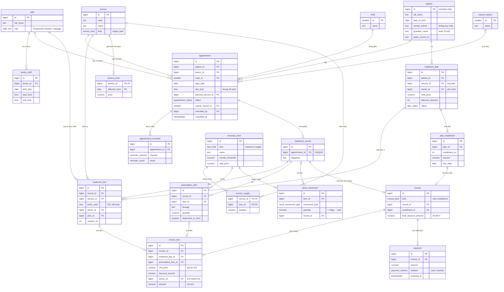

# Thiết kế CSDL — Phòng khám Nha khoa Nụ Cười Việt

> Đi từ [use-case.md](use-case.md). DDL đầy đủ: [db/schema.sql](../../db/schema.sql). Dữ liệu mẫu: [db/seed.sql](../../db/seed.sql). Database: `TranquilClinicDB`.
> PostgreSQL 18. Tiền VND kiểu `numeric(12,0)`. Ngày giờ phòng khám theo `Asia/Ho_Chi_Minh` (hàm `local_date()`).

---

## 1. Sơ đồ ERD

> Xem trong VS Code bằng extension **Markdown Preview Mermaid Support**, hoặc mở file trên GitHub. Sơ đồ chỉ hiện khóa và cột chính; cột đầy đủ xem trong `schema.sql`.



Hai bảng không có quan hệ khóa ngoại nên không vẽ: **`cash_closing`** (chốt két theo ngày, PK `closing_date`) và **`audit_log`** (lịch sử sửa, trỏ tới dòng bị sửa qua `table_name` + `row_id`).

---

## 2. Danh sách bảng

| Nhóm | Bảng | Một dòng là | Use case |
|---|---|---|---|
| Nhân sự | `staff` | một nhân viên | UC01, UC63 |
| | `chair` | một ghế máy | UC62 |
| | `doctor_shift` | ca trực của một bác sĩ trong một ngày | UC61 |
| Danh mục | `service` | một dịch vụ hoặc một loại liệu trình | UC62 |
| | `service_price` | giá của dịch vụ từ một ngày hiệu lực | UC60, UC40 |
| | `cancel_reason` | một lý do hủy | UC62 |
| | `inventory_item` | một loại thuốc hoặc vật tư | UC62 |
| | `service_supply` | định mức một vật tư cho một dịch vụ | UC62 |
| Bệnh nhân | `patient` | một người (kể cả trẻ dùng chung số) | UC10 – UC12 |
| Lịch hẹn | `appointment` | một lịch = 1 bác sĩ + 1 ghế + 1 khung | UC20 – UC24, UC27 – UC29 |
| | `appointment_reminder` | một lần gọi nhắc hoặc gửi SMS | UC25, UC26 |
| Điều trị | `treatment_record` | một phiếu điều trị (một lượt khám) | UC31 |
| | `treatment_line` | một việc đã làm ở một răng | UC31, UC33 |
| | `treatment_plan` | một liệu trình | UC34, UC76 |
| | `plan_installment` | một đợt trả tiền dự kiến | UC34, UC42 |
| | `prescription_item` | một thuốc trong đơn | UC32 |
| Kho | `stock_movement` | một lần nhập / xuất | UC50, UC51 (tự động từ UC31, UC32) |
| Thu ngân | `invoice` | một hóa đơn lượt khám hoặc đợt liệu trình | UC41, UC42 |
| | `invoice_line` | một dòng tiền, giá + giảm giá đã chốt | UC41 – UC43 |
| | `payment` | một lần thu | UC44 |
| | `cash_closing` | kết quả chốt két một ngày | UC45, UC79 |
| Kiểm soát | `audit_log` | một lần thêm / sửa / xóa trên phiếu hoặc liệu trình | UC35, UC36 |

**View** (không lưu, tính khi đọc): `invoice_balance` (tổng / đã thu / còn nợ từng hóa đơn), `inventory_stock` (tồn kho, cờ dưới ngưỡng), `plan_progress` (số buổi đã làm, còn lại, đã thu của liệu trình).

---

## 3. Luật nghiệp vụ → ràng buộc trong CSDL

| Luật | Cách ép trong CSDL |
|---|---|
| LN-01 Nhận biết bằng SĐT, trùng tên thường | `patient.contact_phone` có index nhưng **không** UNIQUE; khóa thật là `patient.id` |
| LN-02 Một lịch = 1 bác sĩ, 1 ghế, 1 khung 30 phút | Mỗi cột NOT NULL; `CHECK is_valid_slot()` (phút 00/30, 8h–19h30, Chủ nhật đến 16h30) |
| LN-03 Không trùng giờ cùng ghế / cùng bác sĩ | Hai **partial unique index** trên `(doctor_id, ngày, khung)` và `(chair_id, ngày, khung)` `WHERE status <> 'cancelled'` |
| LN-04 Mỗi việc phải ghi số răng | `tooth_code NOT NULL` + `CHECK` theo mẫu FDI |
| LN-05 Hóa đơn giữ giá lúc làm | `service_price` lưu cả giá cũ; giá được **chép** vào `invoice_line.unit_price` |
| LN-06 Liệu trình, tiền theo đợt | `treatment_plan` + `plan_installment`; hóa đơn `kind = 'installment'` |
| LN-07 Thuốc theo lần khám, liều, số lượng | `prescription_item.record_id`, `dosage`, `quantity` NOT NULL |
| LN-08 Thu nhiều lần, ghi hình thức | Bảng `payment` nhiều dòng / hóa đơn, `method` NOT NULL |
| LN-09 Luôn biết còn nợ | View `invoice_balance`; trigger `payment_check` chặn thu quá số còn nợ (khóa dòng hóa đơn khi hai lễ tân thu cùng lúc) |
| LN-10 Hủy lịch ghi lý do, ai, lúc nào | `CHECK`: `status = 'cancelled'` ⇔ đủ `cancel_reason_id`, `cancelled_by`, `cancelled_at` |
| LN-11 Chỉ xếp lịch vào ca trực | Trigger `appointment_in_shift`; `doctor_shift` chỉ nhận nhân viên `role = 'dentist'` (khóa ngoại kép `(id, role)`) |
| LN-12 Giữ hồ sơ 5 năm | Trigger `forbid_delete` trên `patient`, `appointment`, `treatment_record`, `treatment_plan`, `invoice`, `payment` |
| LN-13 Sửa phiếu biết ai, lúc nào | Trigger `audit_row` ghi `audit_log` (cũ → mới, lý do, người sửa); thiếu `app.staff_id` thì **từ chối ghi** |
| LN-14 Vật tư trừ khi dùng, báo khi dưới ngưỡng | Trigger tự ghi `stock_movement` theo `service_supply` và khi cấp thuốc; hoàn kho khi sửa / xóa dòng; view `inventory_stock.below_threshold` |

Thêm các luật từ giả định trong use case:

| Giả định | Cách ép |
|---|---|
| GT-11 Hóa đơn đã thu thì không đổi dịch vụ / giá | Trigger `invoice_line_lock`, `treatment_line_lock` |
| UC45 Ngày đã chốt két thì khóa khoản thu | Trigger `payment_check`; `cash_closing.expected_cash` do trigger tự cộng từ tiền mặt |
| Liệu trình phải là dịch vụ loại `plan` | Khóa ngoại kép `(service_id, service_kind)` |
| Định mức chỉ dùng vật tư, đơn thuốc chỉ dùng thuốc | Khóa ngoại kép `(item_id, item_kind)` |

---

## 4. Ba chỗ làm mỗi lần một kiểu → cột nào giữ

| Chỗ | Thiết kế |
|---|---|
| Hai bác sĩ cùng làm | `appointment.doctor_id` = bác sĩ chính (1 người). `treatment_line.doctor_id` = người làm từng việc. `invoice_line.doctor_id` = người được tính doanh thu |
| Trẻ dùng chung số của mẹ | `patient.id` riêng mỗi người; `contact_phone` không UNIQUE; `guardian_name`, `guardian_relation` |
| Giảm giá ở tổng hay ở dòng | Chỉ lưu `invoice_line.discount_amount`. `invoice.total_discount_amount` + `discount_reason` chỉ để in lại đúng như khách thấy; ứng dụng phân bổ số này xuống các dòng theo tỷ lệ thành tiền |

---

## 5. Tám câu quản lý hỏi → dữ liệu trả lời

| Câu | Lấy từ | Truy vấn |
|---|---|---|
| Q1 Doanh thu mỗi bác sĩ | `invoice_line.amount` theo `doctor_id`, hóa đơn lập trong tháng | Q1 |
| Q2 Ghế trống nhiều nhất, khung nào | Hàm `clinic_slots()` sinh mọi khung × `chair`, LEFT JOIN `appointment` chưa hủy | Q2 |
| Q3 Quá 6 tháng chưa quay lại | Ngày lớn nhất của `appointment` có `treatment_record`; loại người đã có hẹn sắp tới | Q3 |
| Q4 Việc hay bị hủy, lý do | `appointment.planned_service_id` × `cancel_reason_id` với `status = 'cancelled'` | Q4 |
| Q5 Nợ theo từng người | View `invoice_balance.remaining > 0`, có dòng tổng cộng | Q5 |
| Q6 Liệu trình dở, còn mấy buổi | View `plan_progress` (`planned_sessions` − số phiếu đã có dòng thuộc liệu trình) | Q6 |
| Q7 Thuốc / vật tư sắp hết | View `inventory_stock.below_threshold` | Q7 |
| Q8 Tăng giảm so với tháng trước | Tổng `invoice_line.amount` theo tháng lập hóa đơn | Q8 |

---

## 6. Giả định thêm khi thiết kế CSDL

| Mã | Giả định |
|---|---|
| GT-17 | Ứng dụng phải chạy `SET LOCAL app.staff_id = '<id>'` (và `app.change_reason` nếu có) trong mỗi transaction ghi phiếu, liệu trình, kho. Trigger đọc giá trị này để biết ai sửa. |
| GT-18 | Phiếu điều trị không chép lại ngày, giờ, ghế, bác sĩ chính, bệnh nhân: lấy qua `appointment_id`. Khách vãng lai (UC29) cũng có một dòng `appointment`. |
| GT-19 | Giá chốt khi **lập hóa đơn**, theo giá hiệu lực vào **ngày khám** (`service_price_at(service_id, ngày khám)`), không phải giá ngày lập hóa đơn. |
| GT-20 | Dòng thuộc liệu trình không vào hóa đơn lượt khám. Hóa đơn đợt có một dòng không trỏ tới `treatment_line`, `doctor_id` = bác sĩ phụ trách liệu trình. |
| GT-21 | Hoàn kho khi sửa dòng dùng **định mức hiện tại**. Nếu quản lý đổi định mức giữa lúc lập và lúc sửa phiếu thì tồn có thể lệch, cần điều chỉnh bằng UC51. |
| GT-22 | Đổi ca trực sau khi đã có lịch hẹn không tự kiểm lại các lịch cũ; ứng dụng phải cảnh báo khi quản lý rút ngắn ca. |
| GT-23 | Bắt buộc người giám hộ cho trẻ dưới 15 tuổi do ứng dụng kiểm (tuổi thay đổi theo thời gian nên không viết thành `CHECK`). Cùng lý do: bệnh nhân trên dòng việc liệu trình phải trùng bệnh nhân của liệu trình, và tổng các đợt phải bằng `total_price`, do ứng dụng kiểm. |

---

## 7. Tạo database TranquilClinicDB

```powershell
powershell -ExecutionPolicy Bypass -File db/create-database.ps1
```

| File | Việc |
|---|---|
| [db/create-database.sql](../../db/create-database.sql) | Tạo user `TranAdmin` (chủ database, không phải superuser) và database `TranquilClinicDB`; chặn user khác kết nối; múi giờ mặc định `Asia/Ho_Chi_Minh` |
| [db/schema.sql](../../db/schema.sql) | 22 bảng, 3 view, trigger — chạy bằng `TranAdmin` để bảng thuộc về user này |
| [db/seed.sql](../../db/seed.sql) | Dữ liệu mẫu cho mọi bảng, "hôm nay" là 2026-11-03 |

Tên user, database, mật khẩu lấy từ `CLINIC_DB_*` trong `.env`. Script chép file vào container rồi chạy bằng `-f` để giữ nguyên tiếng Việt có dấu. Mỗi file chạy trong một transaction: lỗi giữa chừng thì không tạo gì. Database đã có bảng thì script bỏ qua schema và seed.

Dữ liệu mẫu có đủ các tình huống: hai bác sĩ cùng làm một lượt, mẹ và hai con chung SĐT, giảm giá ở tổng, liệu trình niềng và implant trả theo đợt, khách không hẹn, khách không đến, lịch hủy có lý do, khách trả thiếu, ngày đã chốt két, vật tư dưới ngưỡng, giá trám đổi từ 01/11.
