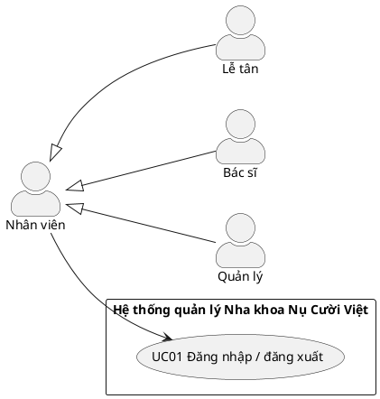
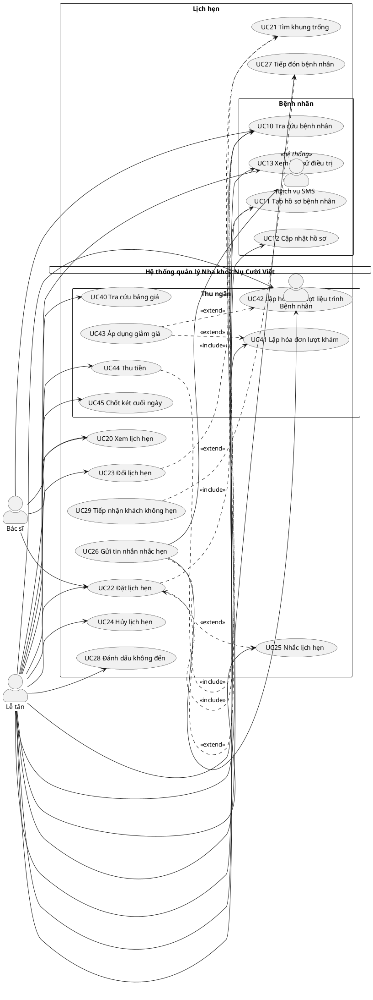
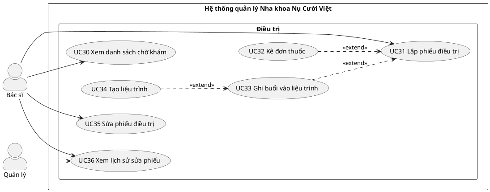
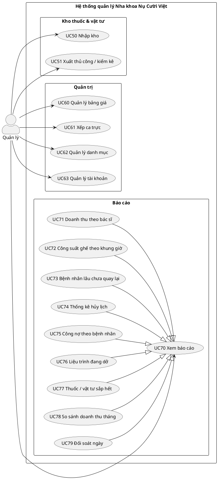

# Use case — Hệ thống quản lý Phòng khám Nha khoa Nụ Cười Việt

> Phạm vi: hệ thống web nội bộ thay cho sổ hẹn giấy, file Excel bảng giá, phiếu điều trị viết tay, việc ghi nợ ở góc phiếu và đối soát két cuối ngày.
> Nguồn: ghi chép khảo sát (Bài tập 1, phần 1/2 và 2/2). Mẫu sổ hẹn, phiếu điều trị, bảng giá trong `dac-ta-phong-kham.md` **chưa có trong thư mục** — các trường dữ liệu ở đây suy ra từ đề, cần đối chiếu lại khi có file.

---

## 1. Tác nhân (Actor)

| Tác nhân | Loại | Vai trò trong hệ thống |
|---|---|---|
| **Nhân viên** | Trừu tượng | Cha của Lễ tân, Bác sĩ, Quản lý — gom chung quyền đăng nhập |
| **Lễ tân** | Chính | Tra cứu / tạo hồ sơ, đặt – đổi – hủy hẹn, nhắc hẹn, tiếp đón, lập hóa đơn, thu tiền, chốt két |
| **Bác sĩ** | Chính | Xem bệnh nhân chờ khám, lập & sửa phiếu điều trị, kê đơn, quản lý liệu trình, hẹn buổi sau |
| **Quản lý** | Chính | Xếp ca, bảng giá, danh mục, tài khoản, kho thuốc & vật tư, toàn bộ báo cáo |
| **Bệnh nhân** | Phụ | **Không đăng nhập hệ thống** (GT-01). Chỉ nhận tin nhắn nhắc hẹn |
| **Dịch vụ SMS** | Hệ thống ngoài | Cổng gửi tin nhắn nhắc hẹn |

---

## 2. Luật nghiệp vụ (từ khảo sát)

| Mã | Luật | Use case chịu trách nhiệm |
|---|---|---|
| LN-01 | Nhận biết bệnh nhân bằng SĐT; trùng tên là chuyện thường | UC10, UC11 |
| LN-02 | Một lịch hẹn gắn **đúng một** bác sĩ, một ghế, một khung 30 phút | UC22 |
| LN-03 | Cùng ghế, hoặc cùng bác sĩ, không có hai lịch trùng giờ | UC21, UC22, UC23 |
| LN-04 | Một lần khám làm nhiều việc; mỗi việc **phải** ghi số răng | UC31 |
| LN-05 | Bảng giá đổi theo thời gian; hóa đơn đã lập giữ giá lúc làm | UC60, UC41 |
| LN-06 | Niềng răng, implant gom thành liệu trình nhiều buổi, **tiền trả theo đợt** | UC33, UC34, UC42 |
| LN-07 | Thuốc kê theo từng lần khám, ghi liều dùng và số lượng | UC32 |
| LN-08 | Một hóa đơn thu nhiều lần; mỗi lần ghi tiền mặt hay chuyển khoản | UC44 |
| LN-09 | Lúc nào cũng biết một hóa đơn còn nợ bao nhiêu | UC44, UC75 |
| LN-10 | Hủy lịch phải ghi lý do, ai hủy, lúc nào | UC24 |
| LN-11 | Bác sĩ có ca trực theo ngày; chỉ xếp lịch vào ca bác sĩ đó trực | UC61, UC21 |
| LN-12 | Giữ hồ sơ bệnh nhân **5 năm** | Toàn hệ thống (không có chức năng xóa) |
| LN-13 | Sửa phiếu điều trị phải biết ai sửa, lúc nào | UC35, UC36 |
| LN-14 | Vật tư trừ khi dùng; dưới ngưỡng phải báo để đặt thêm | UC31, UC32, UC77 |

---

## 3. Ba chỗ phòng khám làm mỗi lần một kiểu — cách xử lý đã chọn

### 3.1 Hai bác sĩ cùng làm cho một khách
- **Lịch hẹn vẫn chỉ có một bác sĩ** (LN-02) — gọi là *bác sĩ chính*.
- Trên phiếu điều trị, **mỗi dòng việc ghi bác sĩ thực hiện**, mặc định là bác sĩ chính, có thể chọn bác sĩ khác đang trực.
- Phiếu hiện tên mọi bác sĩ có dòng việc → khớp thói quen "hồ sơ ghi hai tên".
- Doanh thu chia theo bác sĩ của **từng dòng** → trả lời được câu hỏi Q1 mà không phải chia đôi tùy tiện.

### 3.2 Trẻ dưới 15 tuổi dùng chung số của mẹ
- Mỗi người có **một hồ sơ riêng với mã bệnh nhân riêng**; mã bệnh nhân mới là khóa thật, SĐT chỉ là *SĐT liên hệ* (không duy nhất).
- Hồ sơ dưới 15 tuổi có thêm *người giám hộ* (tên, quan hệ). SĐT liên hệ là số của người giám hộ.
- Tra SĐT trả về **danh sách** mọi hồ sơ dùng số đó (mẹ + hai chị em); lễ tân chọn theo tên và ngày sinh.
- Khi trẻ có số riêng, lễ tân đổi SĐT liên hệ (UC12); lịch sử điều trị không bị ảnh hưởng.

### 3.3 Giảm giá khi ở tổng, khi ở từng dòng
- Giao diện cho phép **cả hai** cách nhập (UC43).
- Nhưng **chỉ lưu ở cấp dòng**: giảm ở tổng sẽ được hệ thống phân bổ xuống từng dòng theo tỷ lệ thành tiền (phần lẻ dồn vào dòng cuối). Hóa đơn vẫn ghi lại "giảm ở tổng X đồng, lý do …" để in đúng như khách thấy.
- Nhờ vậy doanh thu từng bác sĩ (Q1) và doanh thu tháng (Q8) luôn tính trên số **sau giảm**, một cách duy nhất.

---

## 4. Danh sách use case

### 4.1 Chung
| Mã | Use case | Tác nhân |
|---|---|---|
| UC01 | Đăng nhập / đăng xuất | Nhân viên |

### 4.2 Bệnh nhân
| Mã | Use case | Tác nhân |
|---|---|---|
| UC10 | Tra cứu bệnh nhân (SĐT, tên, ngày sinh) | Lễ tân, Bác sĩ |
| UC11 | Tạo hồ sơ bệnh nhân (kèm người giám hộ nếu dưới 15 tuổi) | Lễ tân |
| UC12 | Cập nhật hồ sơ bệnh nhân | Lễ tân |
| UC13 | Xem lịch sử điều trị | Lễ tân, Bác sĩ |

### 4.3 Lịch hẹn
| Mã | Use case | Tác nhân |
|---|---|---|
| UC20 | Xem lịch hẹn (theo ngày / bác sĩ / ghế) | Lễ tân, Bác sĩ, Quản lý |
| UC21 | Tìm khung trống | Lễ tân, Bác sĩ |
| UC22 | Đặt lịch hẹn | Lễ tân, Bác sĩ |
| UC23 | Đổi lịch hẹn | Lễ tân |
| UC24 | Hủy lịch hẹn (lý do, người hủy, thời điểm) | Lễ tân |
| UC25 | Nhắc lịch hẹn | Lễ tân |
| UC26 | Gửi tin nhắn nhắc hẹn | Lễ tân → Dịch vụ SMS → Bệnh nhân |
| UC27 | Tiếp đón bệnh nhân (check-in) | Lễ tân |
| UC28 | Đánh dấu không đến | Lễ tân |
| UC29 | Tiếp nhận khách không hẹn | Lễ tân |

### 4.4 Điều trị
| Mã | Use case | Tác nhân |
|---|---|---|
| UC30 | Xem danh sách chờ khám | Bác sĩ |
| UC31 | Lập phiếu điều trị | Bác sĩ |
| UC32 | Kê đơn thuốc | Bác sĩ |
| UC33 | Ghi buổi vào liệu trình | Bác sĩ |
| UC34 | Tạo liệu trình (tổng giá, số buổi dự kiến, kế hoạch đợt trả) | Bác sĩ |
| UC35 | Sửa phiếu điều trị | Bác sĩ |
| UC36 | Xem lịch sử sửa phiếu | Bác sĩ, Quản lý |

### 4.5 Thu ngân
| Mã | Use case | Tác nhân |
|---|---|---|
| UC40 | Tra cứu bảng giá | Lễ tân |
| UC41 | Lập hóa đơn lượt khám | Lễ tân |
| UC42 | Lập hóa đơn đợt liệu trình | Lễ tân |
| UC43 | Áp dụng giảm giá | Lễ tân |
| UC44 | Thu tiền (một lần thu cho một hóa đơn) | Lễ tân |
| UC45 | Chốt két cuối ngày | Lễ tân |

### 4.6 Kho thuốc & vật tư
| Mã | Use case | Tác nhân |
|---|---|---|
| UC50 | Nhập kho | Quản lý |
| UC51 | Xuất kho thủ công / điều chỉnh sau kiểm kê | Quản lý |

> Phần **trừ kho khi dùng** không phải use case riêng: hệ thống tự trừ khi lưu phiếu điều trị (theo định mức vật tư của dịch vụ) và khi cấp thuốc tại phòng khám (UC31, UC32).

### 4.7 Quản trị
| Mã | Use case | Tác nhân |
|---|---|---|
| UC60 | Quản lý bảng giá (giá có ngày hiệu lực) | Quản lý |
| UC61 | Xếp ca trực bác sĩ theo ngày | Quản lý |
| UC62 | Quản lý danh mục (ghế, dịch vụ, thuốc, vật tư + định mức & ngưỡng, lý do hủy) | Quản lý |
| UC63 | Quản lý tài khoản nhân viên | Quản lý |

### 4.8 Báo cáo — trả lời 8 câu quản lý hỏi hằng tháng
| Mã | Use case | Câu hỏi |
|---|---|---|
| UC70 | Xem báo cáo *(trừu tượng)* | — |
| UC71 | Doanh thu theo bác sĩ | Q1 — Tháng này mỗi bác sĩ làm ra bao nhiêu tiền |
| UC72 | Công suất ghế theo khung giờ | Q2 — Ghế nào trống nhiều nhất, vào khung giờ nào |
| UC73 | Bệnh nhân lâu chưa quay lại | Q3 — Ai quá 6 tháng chưa quay lại |
| UC74 | Thống kê hủy lịch | Q4 — Việc gì hay bị hủy nhất, vì lý do gì |
| UC75 | Công nợ theo bệnh nhân | Q5 — Tổng tiền khách còn nợ, chia theo người |
| UC76 | Liệu trình đang dở | Q6 — Liệu trình nào đang dở, còn mấy buổi |
| UC77 | Thuốc / vật tư sắp hết | Q7 — Thuốc hay vật tư nào sắp hết |
| UC78 | So sánh doanh thu với tháng trước | Q8 — Tăng giảm bao nhiêu phần trăm |
| UC79 | Đối soát ngày | (Xem kết quả chốt két UC45) |

UC71 – UC79 là các use case con (generalization) của UC70. Tác nhân: Quản lý.

### 4.9 Quan hệ giữa các use case

| Quan hệ | Ý nghĩa |
|---|---|
| UC22 Đặt lịch `<<include>>` UC21 Tìm khung trống | Đặt hẹn nào cũng phải tìm khung trống |
| UC22 Đặt lịch `<<include>>` UC10 Tra cứu bệnh nhân | Luôn hỏi SĐT trước |
| UC11 Tạo hồ sơ `<<extend>>` UC22 Đặt lịch | Chỉ khi không thấy hồ sơ phù hợp |
| UC23 Đổi lịch `<<include>>` UC21 Tìm khung trống | Đổi giờ cũng phải kiểm tra trùng |
| UC26 Gửi tin nhắn `<<extend>>` UC25 Nhắc lịch | Chỉ khi khách không nghe máy |
| UC27 Tiếp đón `<<include>>` UC10 Tra cứu bệnh nhân | Khách tới đọc SĐT |
| UC29 Khách không hẹn `<<extend>>` UC27 Tiếp đón | Khách vãng lai |
| UC32 Kê đơn `<<extend>>` UC31 Lập phiếu | Chỉ khi cần thuốc |
| UC33 Ghi buổi liệu trình `<<extend>>` UC31 Lập phiếu | Chỉ với niềng răng, implant… |
| UC34 Tạo liệu trình `<<extend>>` UC33 Ghi buổi liệu trình | Chỉ khi là buổi đầu |
| UC43 Giảm giá `<<extend>>` UC41, UC42 | Chỉ khi có giảm giá |
| UC44 Thu tiền `<<include>>` UC10 Tra cứu bệnh nhân | Thu nợ hóa đơn cũ cũng tìm theo SĐT |
| UC71 … UC79 `--|>` UC70 | Các loại báo cáo |
| Lễ tân, Bác sĩ, Quản lý `--|>` Nhân viên | Kế thừa UC01 Đăng nhập |

---

## 5. Sơ đồ use case (PlantUML)

> Tách thành 4 sơ đồ cho dễ đọc. Xem trong VS Code bằng extension **PlantUML**, hoặc dán vào https://www.plantuml.com/plantuml.

### 5.1 Tác nhân

### 5.2 Lễ tân — Bệnh nhân, Lịch hẹn, Thu ngân

### 5.3 Bác sĩ — Điều trị

### 5.4 Quản lý — Kho, Quản trị, Báo cáo

---

## 6. Truy vết: bước trong khảo sát → use case

| # | Bước khảo sát | Use case |
|---|---|---|
| 1 | Khách gọi điện, nói muốn làm gì, muốn bác sĩ nào | UC22; UC40 nếu khách hỏi giá |
| 2 | Lật sổ tìm ô trống của bác sĩ, còn ghế thì nhận | UC21 |
| 3 | Ghi tên, SĐT, việc cần làm, bác sĩ | UC22 (+ UC10 / UC11) |
| 4 | Hôm trước gọi nhắc; không nghe máy thì nhắn tin | UC25, UC26 |
| 5 | Khách tới, hỏi SĐT, rút hồ sơ | UC27 (+ UC10) |
| 6 | Bác sĩ viết phiếu: ngày, giờ, ghế, tên mình | UC31 (hệ thống tự điền) |
| 7 | Mỗi việc một dòng, kèm số răng | UC31 |
| 8 | Ghi thuốc, liều, số lượng | UC32 |
| 9 | Ghi liệu trình nào, buổi thứ mấy | UC33, UC34 |
| 10 | Tra giá Excel từng dòng, cộng tay | UC41 (hệ thống tự tính) |
| 11 | Khách trả; trả thiếu thì ghi nợ ở góc phiếu | UC44 (nợ tự tính, không ghi tay) |
| 12 | Hẹn lần sau, ghi vào sổ hẹn | UC22 |
| 13 | Cuối ngày đếm két, so với phiếu | UC45, UC79 |
| — | Quản lý: xếp ca, chia tiền, sửa giá, theo dõi nợ & vật tư | UC61, UC71, UC60, UC75, UC50/UC77 |

---

## 7. Đặc tả các use case chính

### UC22 — Đặt lịch hẹn
- **Tác nhân:** Lễ tân (chính), Bác sĩ (khi hẹn buổi sau)
- **Tiền điều kiện:** Đã đăng nhập; ngày cần đặt đã có ca trực (UC61).
- **Luồng chính:**
  1. Nhập SĐT → hệ thống trả danh sách hồ sơ dùng số đó (UC10).
  2. Chọn đúng người theo tên + ngày sinh.
  3. Chọn **việc cần làm từ danh mục dịch vụ** (không gõ tự do — để thống kê Q4), bác sĩ mong muốn, ngày mong muốn.
  4. Hệ thống hiện các khung 30 phút thỏa đồng thời (UC21):
     - bác sĩ có ca trực trong khung đó (LN-11);
     - bác sĩ chưa có lịch nào trong khung đó (LN-03);
     - còn ít nhất một ghế chưa có lịch trong khung đó (LN-03).
  5. Chọn khung → hệ thống gán một ghế trống → lưu lịch *Đã đặt*, ghi người đặt và thời điểm.
- **Luồng thay thế:**
  - 2a. Không có hồ sơ phù hợp → UC11, rồi quay lại bước 3.
  - 3a. Khách không chỉ định bác sĩ → hiện khung trống của mọi bác sĩ đang trực.
  - 4a. Hết khung → gợi ý ngày gần nhất còn trống hoặc bác sĩ khác.
  - 5a. Hai lễ tân cùng chọn một khung → người lưu sau nhận thông báo "khung vừa bị đặt", quay lại bước 4.
- **Hậu điều kiện:** Bộ (bác sĩ, khung) và (ghế, khung) đã bị chiếm.

### UC24 — Hủy lịch hẹn
- **Tác nhân:** Lễ tân
- **Luồng chính:**
  1. Tìm lịch hẹn (theo SĐT hoặc trên lịch ngày).
  2. Chọn **lý do hủy từ danh mục** (VD: bận việc, ốm, đổi ý, chi phí, phòng khám đổi lịch, khác + ghi chú).
  3. Xác nhận → lịch chuyển *Đã hủy*; hệ thống tự ghi **người hủy** và **thời điểm hủy** (LN-10). Khung được trả lại.
- **Ghi chú:** Lịch hủy không bị xóa, để thống kê UC74.

### UC25 / UC26 — Nhắc lịch hẹn, gửi tin nhắn
- **Luồng chính:** Lễ tân mở danh sách hẹn **ngày mai** → gọi từng khách (ngoài hệ thống) → ghi kết quả *Đã xác nhận / Xin đổi / Xin hủy / Không nghe máy*. *Xin đổi* → UC23, *Xin hủy* → UC24.
- **Mở rộng (UC26):** Các lượt *Không nghe máy* → lễ tân bấm "Gửi tin nhắn" → hệ thống gửi SMS theo mẫu (tên, giờ, bác sĩ) qua Dịch vụ SMS và lưu trạng thái gửi.

### UC27 / UC28 / UC29 — Tiếp đón, không đến, khách vãng lai
- **UC27:** Khách đọc SĐT → UC10 → hệ thống hiện lịch hôm nay của các hồ sơ dùng số đó → lễ tân *Check-in* → khách vào danh sách chờ của bác sĩ (UC30).
- **UC28:** Hết khung hẹn mà khách chưa tới → lễ tân đánh dấu *Không đến* (dùng cho UC72).
- **UC29:** Khách không có hẹn → lễ tân tìm bác sĩ + ghế trống ngay khung hiện tại (theo LN-02, LN-03) → tạo lịch và check-in luôn.

### UC31 — Lập phiếu điều trị
- **Tác nhân:** Bác sĩ
- **Tiền điều kiện:** Bệnh nhân đã check-in.
- **Luồng chính:**
  1. Chọn bệnh nhân trong danh sách chờ (UC30); có thể xem lịch sử (UC13).
  2. Hệ thống tạo phiếu, **tự điền** ngày, giờ, ghế, bác sĩ chính.
  3. Với mỗi việc đã làm, thêm một dòng: dịch vụ, **số răng (bắt buộc — LN-04)**, bác sĩ thực hiện (mặc định bác sĩ chính — mục 3.1), ghi chú.
  4. Hệ thống hiện **đơn giá đang hiệu lực** ngày khám để bác sĩ tham khảo; giá được chốt khi lập hóa đơn, theo ngày khám (LN-05).
  5. Lưu → hệ thống **trừ kho vật tư theo định mức** của từng dịch vụ (LN-14); phiếu chuyển *Chờ thanh toán*.
- **Mở rộng:**
  - UC32 Kê đơn: mỗi thuốc ghi liều dùng, số lượng, và nơi lấy (*cấp tại phòng khám* → trừ kho + tính tiền; *mua ngoài* → không) — GT-07.
  - UC33 Ghi buổi liệu trình: gắn dòng vào liệu trình đang mở của bệnh nhân; hệ thống tự đánh **buổi thứ n**. Dòng thuộc liệu trình không đưa vào hóa đơn lượt khám (đã nằm trong giá liệu trình).
  - UC34 Tạo liệu trình: khi là buổi đầu.
  - Cần buổi sau → bác sĩ đặt luôn lịch hẹn (UC22).
- **Ngoại lệ:** Tồn kho xuống dưới ngưỡng sau khi trừ → hệ thống báo trên màn hình Quản lý (UC77).

### UC34 — Tạo liệu trình
- **Tác nhân:** Bác sĩ
- **Luồng chính:** Chọn loại liệu trình (niềng răng, implant…) → nhập **tổng giá chốt**, **số buổi dự kiến**, **kế hoạch đợt trả** (số tiền, hạn của từng đợt) → bác sĩ tạo là *bác sĩ phụ trách* → liệu trình ở trạng thái *Đang điều trị*.
- **Kết thúc:** Bác sĩ đóng liệu trình khi xong, hoặc đổi số buổi dự kiến nếu kế hoạch thay đổi (ghi lại lần đổi).

### UC35 / UC36 — Sửa phiếu điều trị, xem lịch sử sửa
- **UC35:** Bác sĩ mở phiếu → sửa → nhập lý do sửa → lưu. Hệ thống ghi một bản lịch sử: **ai sửa, lúc nào, giá trị cũ → giá trị mới** (LN-13).
  - Phiếu đã có hóa đơn **chưa thu đồng nào** → sửa được dòng việc; hóa đơn tự tính lại.
  - Phiếu đã có lần thu → chỉ sửa được ghi chú, chẩn đoán, số răng; không sửa dịch vụ / giá (GT-11).
- **UC36:** Xem danh sách các lần sửa của một phiếu.

### UC41 / UC42 / UC43 — Lập hóa đơn, giảm giá
- **UC41 Hóa đơn lượt khám:** Lễ tân mở phiếu *Chờ thanh toán* → hệ thống lấy các dòng có tính tiền (dịch vụ lẻ + thuốc cấp tại phòng khám) với **đơn giá hiệu lực vào ngày khám**, chép cố định vào dòng hóa đơn → tính tổng. Hóa đơn đã lập không đổi giá dù bảng giá thay đổi sau đó (LN-05).
- **UC42 Hóa đơn đợt liệu trình:** Chọn liệu trình → chọn đợt đến hạn → lập hóa đơn với số tiền của đợt.
- **UC43 Giảm giá (extend):** Nhập giảm theo % hoặc số tiền, ở dòng hoặc ở tổng, kèm lý do. Giảm ở tổng được phân bổ xuống các dòng (mục 3.3).

### UC44 — Thu tiền
- **Tác nhân:** Lễ tân
- **Luồng chính:**
  1. Chọn hóa đơn (ngay sau UC41/UC42, hoặc tra bệnh nhân để thu nợ cũ — UC10).
  2. Hệ thống hiện **tổng tiền, đã thu, còn nợ**.
  3. Nhập số tiền và **hình thức: tiền mặt / chuyển khoản** (LN-08).
  4. Lưu một *lần thu* (số tiền, hình thức, người thu, thời điểm). Còn nợ = tổng − Σ các lần thu (LN-09). Còn nợ = 0 → hóa đơn *Đã thanh toán*.
- **Luồng thay thế:**
  - 3a. Khách trả nhiều hơn số còn nợ → hệ thống chặn, yêu cầu nhập đúng số còn nợ (không giữ tiền thừa).
  - 1a. Khách có nhiều hóa đơn còn nợ → hệ thống liệt kê, gợi ý hóa đơn cũ nhất trước.

### UC45 — Chốt két cuối ngày
- **Luồng chính:** Hệ thống tổng hợp các lần thu **tiền mặt** trong ngày (tách riêng chuyển khoản) → lễ tân nhập số tiền mặt đếm được → hệ thống hiện chênh lệch → lễ tân ghi lý do nếu lệch → chốt. Sau khi chốt, các lần thu của ngày đó bị khóa sửa.

### UC71 – UC78 — Báo cáo quản lý

| UC | Cách tính | Dữ liệu hệ thống phải ghi nhận |
|---|---|---|
| UC71 Doanh thu theo bác sĩ | Σ thành tiền **sau giảm** của các dòng trên hóa đơn lập trong tháng, theo bác sĩ thực hiện dòng + Σ hóa đơn đợt liệu trình lập trong tháng, theo bác sĩ phụ trách liệu trình | Bác sĩ trên từng dòng; giảm giá ở cấp dòng; bác sĩ phụ trách liệu trình |
| UC72 Công suất ghế | Với mỗi ghế × mỗi khung giờ (8:00, 8:30, …) × thứ trong tuần: đếm số khung **không có lịch**, đếm riêng số khung *Không đến* | Lịch gắn ghế + khung; trạng thái lịch; giờ mở cửa (Chủ nhật đến 17h) |
| UC73 Lâu chưa quay lại | Bệnh nhân có ngày khám cuối > 6 tháng trước hôm nay và không có lịch hẹn sắp tới; kèm SĐT để gọi chăm sóc | Ngày của phiếu điều trị |
| UC74 Thống kê hủy | Đếm lịch *Đã hủy* theo dịch vụ dự kiến × lý do hủy, sắp giảm dần | Dịch vụ dự kiến trên lịch hẹn (chọn từ danh mục); lý do hủy (chọn từ danh mục) |
| UC75 Công nợ | Với mỗi bệnh nhân: Σ (tổng hóa đơn − Σ lần thu) > 0; hiện tên, SĐT liên hệ, hóa đơn nợ lâu nhất | Hóa đơn + các lần thu |
| UC76 Liệu trình đang dở | Liệu trình *Đang điều trị*: số buổi đã làm, còn lại = dự kiến − đã làm; tiền đã thu / tổng giá | Số buổi dự kiến; buổi thứ n trên dòng |
| UC77 Sắp hết | Thuốc / vật tư có tồn ≤ ngưỡng; hệ thống cũng **báo ngay** trên màn hình Quản lý khi vừa xuống dưới ngưỡng | Tồn kho, ngưỡng, định mức vật tư theo dịch vụ |
| UC78 So sánh tháng | (DT tháng này − DT tháng trước) / DT tháng trước × 100%; DT = tổng mọi dòng hóa đơn lập trong tháng (gồm cả thuốc) | Như UC71 |

---

## 8. Giả định (những chỗ đề vẫn không nói)

| Mã | Giả định | Ảnh hưởng |
|---|---|---|
| GT-01 | Bệnh nhân **không** đăng nhập / tự đặt lịch online ở giai đoạn này. | Bệnh nhân là tác nhân phụ, chỉ nhận SMS. |
| GT-02 | Giờ mở cửa 8h–20h (Chủ nhật 8h–17h) → 24 khung/ngày (Chủ nhật 18); 3 ghế → 72 khung/ngày, khớp đề. | Quy tắc sinh khung của UC21, UC72. |
| GT-03 | Việc cần hơn 30 phút thì đặt **nhiều lịch hẹn liên tiếp** (mỗi lịch vẫn đúng một khung — LN-02). | UC22 cho phép đặt liền nhiều khung một lượt. |
| GT-04 | Ghế được hệ thống tự gán khi đặt hẹn, lễ tân đổi được (nếu ghế khác trống) khi check-in. | — |
| GT-05 | Số răng theo hệ **FDI**: 11–48 (vĩnh viễn), 51–85 (sữa); việc làm cả vùng dùng mã vùng: 00 cả miệng, 01 hàm trên, 02 hàm dưới. Nhờ vậy số răng luôn bắt buộc (LN-04). | Trường số răng ở UC31. |
| GT-06 | Bác sĩ phụ trong mục 3.1 phải đang có ca trực; hệ thống **cảnh báo** (không chặn) nếu bác sĩ đó đang có lịch khác cùng khung. | UC31. |
| GT-07 | Phòng khám **có tủ thuốc** (vì quản lý hỏi "thuốc sắp hết"). Thuốc cấp tại chỗ thì trừ kho và tính tiền; thuốc ghi "mua ngoài" thì không. | UC32, UC41, UC77. |
| GT-08 | Mỗi dịch vụ có **định mức vật tư** do Quản lý khai báo; lưu phiếu thì tự trừ. Vật tư dùng ngoài phiếu (hỏng, thử) thì xuất thủ công. | UC31, UC51, UC62. |
| GT-09 | Liệu trình có **tổng giá chốt lúc tạo**; các buổi trong liệu trình không tính tiền riêng; mỗi đợt trả là một hóa đơn. Dịch vụ ngoài liệu trình làm cùng buổi vẫn tính ở hóa đơn lượt khám. | UC33, UC34, UC41, UC42. |
| GT-10 | Một lượt khám có tối đa **một** hóa đơn lượt khám; buổi chỉ có việc thuộc liệu trình thì có thể không có hóa đơn. | Quan hệ phiếu – hóa đơn là 1 – 0..1. |
| GT-11 | Sau khi hóa đơn đã có lần thu, không sửa dịch vụ / giá trên phiếu nữa (tránh lệch tiền đã thu). | UC35. |
| GT-12 | "Làm ra bao nhiêu tiền" = doanh thu theo hóa đơn **lập** trong tháng, sau giảm giá, chưa trừ nợ. Nợ theo dõi riêng ở UC75. Tiền thuốc tính vào doanh thu phòng khám (UC78) nhưng **không** tính cho bác sĩ (UC71). Tỷ lệ chia lương cho bác sĩ nằm ngoài hệ thống. | UC71, UC78. |
| GT-13 | Chốt két chỉ đối chiếu tiền mặt; chuyển khoản đối chiếu với sao kê ngân hàng (ngoài hệ thống). | UC45. |
| GT-14 | Giữ hồ sơ 5 năm tính từ **lần khám cuối**. Hệ thống **không có chức năng xóa** bệnh nhân, phiếu, hóa đơn, lịch hẹn; chỉ có trạng thái *ngừng hoạt động*. | LN-12. |
| GT-15 | **Không số hóa hàng loạt** 4.100 hồ sơ giấy. Bệnh nhân cũ quay lại thì tạo hồ sơ điện tử, ghi số hồ sơ giấy để tra khi cần; hồ sơ giấy vẫn lưu đủ 5 năm. | UC11. |
| GT-16 | Hai lễ tân có quyền như nhau. Quản lý xem mọi thứ nhưng không thao tác thay lễ tân hay bác sĩ. Bác sĩ chỉ sửa phiếu do mình lập. | Phân quyền. |

---

## 9. Câu hỏi cần xác nhận với phòng khám
1. Phòng khám có tính tiền thuốc cấp tại chỗ không, hay cấp miễn phí? (GT-07)
2. Định mức vật tư theo dịch vụ có ổn không, hay bác sĩ muốn tự ghi vật tư đã dùng mỗi buổi? (GT-08)
3. Liệu trình có khi nào đổi tổng giá giữa chừng không (thêm răng, đổi loại mắc cài…)? (GT-09)
4. Doanh thu bác sĩ tính theo tiền **đã thu** hay theo hóa đơn **đã lập**? (GT-12)
5. Khi có file `dac-ta-phong-kham.md`: đối chiếu các trường của sổ hẹn, phiếu điều trị và bảng giá với UC22, UC31, UC60.
